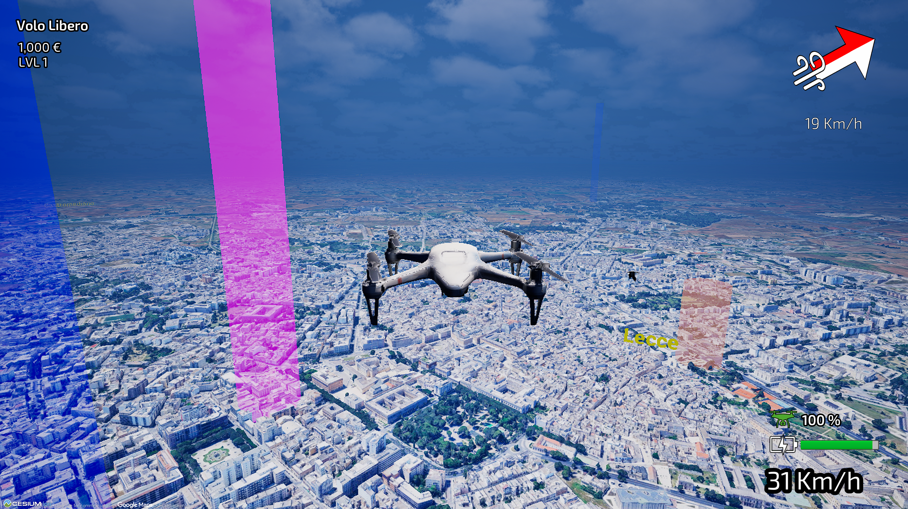
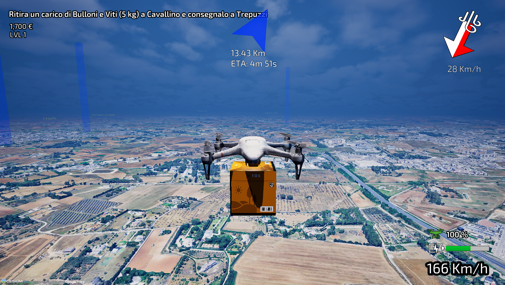
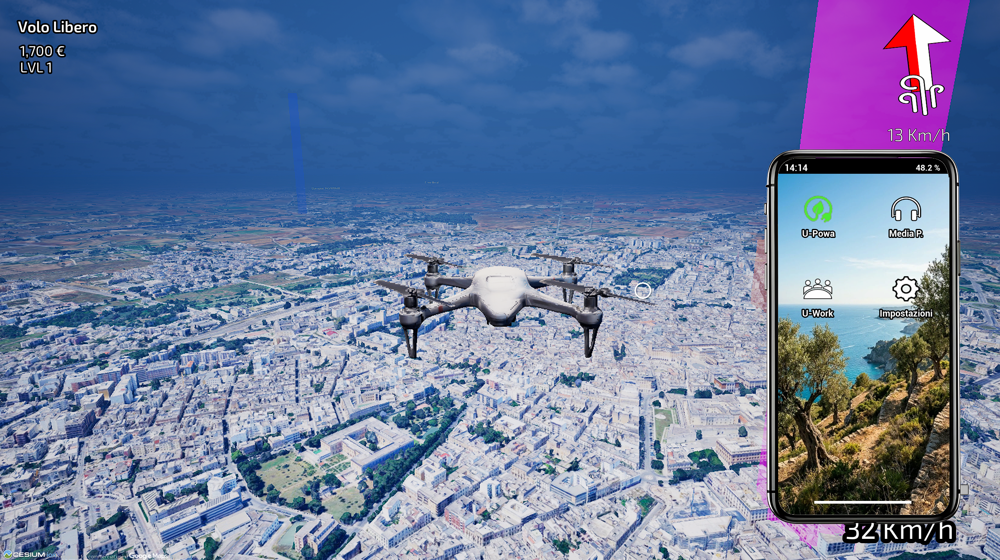
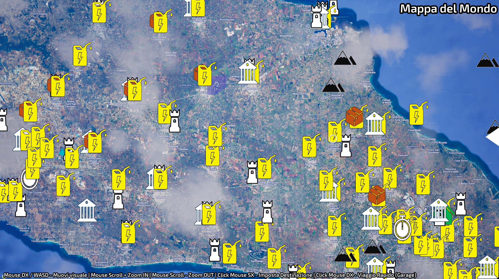
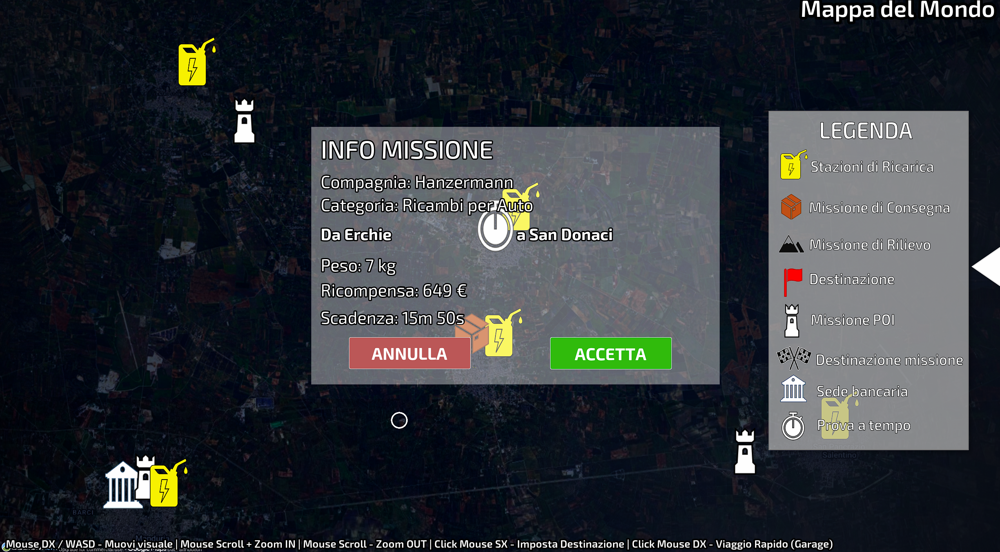
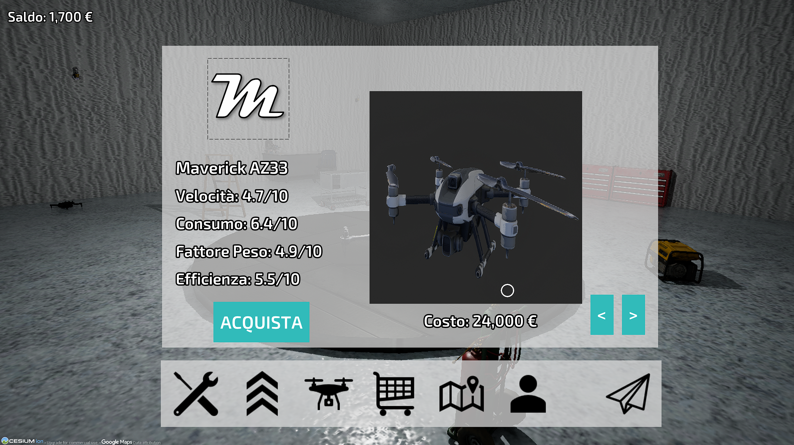
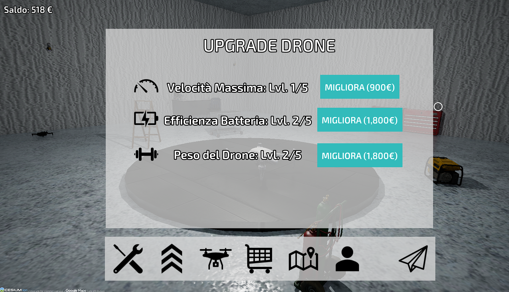
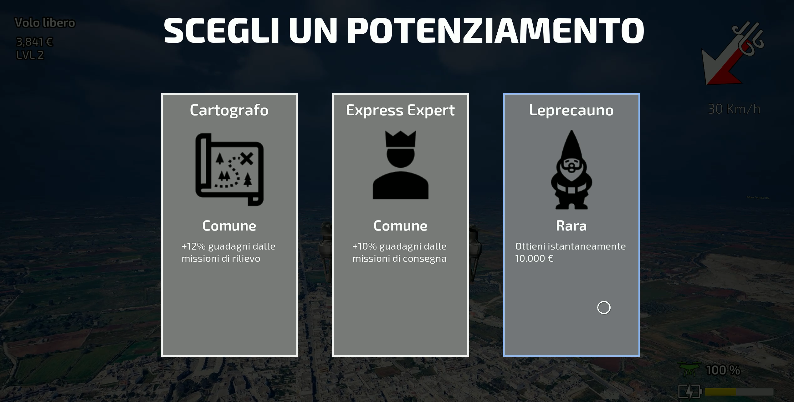

# Drone Express Simulator

Questo repository è una scheda di presentazione: contiene documentazione, screenshot e dataset.

Simulatore logistico 3D georeferenziato sviluppato in Unreal Engine 5 utilizzando il plugin Cesium for Unreal, ambientato su una riproduzione reale della Puglia (ma con possibilità di mappatura in tutto il mondo).

Inizia la tua carriera da pilota di droni, effettua varie tipologie di missioni (consegna, sia normali che speciali, missioni di fotografia e rilievo, prove a tempo) e cresci professionalmente, sbloccando nuovi droni e migliorando il tuo profilo!

## Video Dimostrativo

Video in arrivo!

## Screenshot

| | |
| :---: | :---: |
|  *Volo libero sopra Lecce con Tileset 3D Cesium, indicatori di località e HUD della telemetria di bordo (velocità, batteria e vento).* |  *Gameplay di una missione di consegna attiva (Bulloni e Viti, 5 kg da Cavallino a Trepuzzi) con calcolo in tempo reale di distanza ed ETA verso la destinazione.* |
|  *Interfaccia smartphone in-game con accesso rapido alle app dedicate (U-Powa, Media P., U-Work, Impostazioni) e barra di stato indicante l'orario attuale e la percentuale di batteria (del drone).* |  *Vista 2D della mappa georeferenziata con Cesium del territorio con icone riguardanti stazioni di ricarica, sedi bancarie, POI, prove a tempo, con indicazione in basso a sinistra dei controlli di navigazione.* |
|  *Pannello informativo dei contratti generati dinamicamente (compagnia, merce, peso, ricompensa, scadenza) con legenda completa e vista della mappa notturna.* |  *Officina e flotta: anteprima 3D e caratteristiche tecniche dei droni (Maverick AZ33) letti tramite Data Table dai file CSV.* |
|  *Sistema di potenziamento progressivo per velocità massima, efficienza della batteria e influenza del pacco sul peso del drone.* |  *Schermata di Level-Up con sistema draft composto da 3 carte abilità permanenti divise per rarità (Comune e Rara).* |

## Funzioni completate

### Pilotaggio, Fisica e Sopravvivenza

**Modello di Volo e Caratteristiche Mezzi:** Ogni drone possiede statistiche distinte di Velocità Base, Autonomia, Fattore Peso (capacità di carico) e consumo in termini di energia.

**Sistema di Danni del drone:** Gli impatti riducono l'integrità del mezzo; sotto una certa soglia il drone subisce avarie temporanee ai motori. Allo 0% viene attivato il recupero d'emergenza verso l'officina più vicina.

**Gestione Batteria/Carburante:** Consumo dinamico legato a velocità e carico trasportato, con stazioni di ricarica distribuite sul territorio.

**Navigazione e Sicurezza:** Calcolo in tempo reale di distanza rimanente ed ETA verso una destinazione e No-Fly Zone (aeroporti e aree interdette).

### Missioni e Attività

**Scelta Compagnia Iniziale:** Selezione dell'azienda e della città dove collocare il proprio hub di partenza all'inizio della carriera.

**Consegne Standard e Merci ADR:** Contratti generati dinamicamente con pacchi di peso variabile; al raggiungimento del Livello 2 si sbloccano le missioni ADR (liquidi, materiali infiammabili e carichi delicati).

**Rilievi e Fotografia POI:** Missioni di ispezione e fotografia di Punti di Interesse reali (con sblocco di un drone speciale al raggiungimento di 100 POI fotografati).

**Sfide e Collezionabili:** Prove a tempo con percorsi composti da checkpoint aerei, mongolfiere di rifornimento e droni collezionabili nascosti nelle varie province da scovare e riscattare.

### Economia, Progressione e Gestionale

**Sistema XP e Abilità Permanenti:** Guadagno di esperienza in base a distanza e difficoltà, con punti livello spendibili in carte abilità permanenti.

**Officina e Flotta:** Acquisto di nuovi droni (tra cui modelli enterprise e speciali), riparazione dei danni e potenziamento delle singole statistiche individuali dei droni posseduti.

**Sistema Bancario:** Richiesta ed estinzione di prestiti tramite un'interfaccia finanziaria dedicata.

**Mercato Carburante Dinamico:** Più fornitori energetici con tariffe variabili nel tempo monitorabili da un'app accessibile dallo smartphone in gioco.

### Smartphone OS & Interfaccia

**Smartphone In-Game:** Interfaccia multifunzione con app per bacheca lavori, prezzi carburante, banca, messaggi/email di sistema e personalizzazione sfondo.

**Mappa Interattiva:** Navigazione completa con zoom, pan e impostazione rapida dei waypoint tramite click sui marker.

**Radio Locale:** Player integrato in grado di riprodurre file audio personali caricati da una cartella locale del PC.

**Flusso Utente:** Sequenza tutorial iniziale, menu principale, menu di pausa e impostazioni.

### Mondo di Gioco e Ambiente

**Territorio Georeferenziato:** Mappa 3D della Puglia con dati geografici di comuni, province e POI reali.

**Ciclo Giorno/Notte e Meteo:** Alternanza dinamica delle ore del giorno, pioggia e raffiche di vento forte che influenzano fisicamente e continuamente la manovrabilità del drone.

**Mondo Vivo:** Traffico aereo composto da altri droni controllati dal computer e uccelli che fungono da ostacoli dinamici.

## Sezione tecnica

L'architettura del progetto è stata progettata con un approccio data-driven in Unreal Engine 5 (principalmente utilizzando la logica Blueprints con componenti C++ di supporto dove richiesto):

**Gestione Dati con Data Table e CSV:** Le entità principali del mondo — comuni, province, coordinate, POI, listino droni, tipologie di carico e fornitori di energia — sono strutturate in file .csv esterni e importate tramite Data Table.

**Generazione Dinamica delle Missioni:** Un algoritmo seleziona origine, destinazione e tipologia di carico interrogando le Data Table territoriali, calcolando la distanza geografica e determinando il compenso in base a peso del carico, rischio (es. ADR) e livello del giocatore.

**Macchina a Stati (State Machine):** Il ciclo di vita del drone e delle sessioni di gioco è regolato tramite stati ben definiti (Idle/Garage, In Volo, Avaria/Malfunzionamento, Ricarica, Recupero d'Emergenza, Interazione UI), garantendo transizioni pulite tra controlli di volo, input dello smartphone e schermate gestionali.

**Persistenza Dati (SaveGame):** Sistema centralizzato nella GameInstance che serializza e deserializza su disco lo stato completo della carriera: saldo bancario, prestiti attivi, livello XP, abilità sbloccate, flotta posseduta, integrità dei singoli droni, POI fotografati e posizione geografica.

**Integrazione Cesium GIS:** Utilizzo del plugin Cesium for Unreal per lo streaming di 3D Tilesets fotogrammetrici e terreno reale, ma anche streaming di Tilesets 2D per la visualizzazione mappa dall'alto, con conversione tra coordinate geografiche (Latitudine / Longitudine) e coordinate del mondo UE5, oltre al campionamento altimetrico asincrono (Funzione SampleHeightMostDetailed) per il posizionamento preciso di modelli sul suolo di gioco.

## Stato del progetto & Prossime funzionalità previste

Il progetto si trova attualmente in versione giocabile (Windows). Il core loop economico, il sistema di volo e l'infrastruttura dati sono completi e funzionanti; restano da finalizzare le seguenti feature previste per le prossime release:

- [ ] Eventi Meteo Estremi: Implementazione dei temporali con fulmini e meccanica Quick-Time Event (rallentamento temporale e barra di schivata).

- [ ] Espansione Gestionale (Flotta Passiva): Possibilità di acquistare ulteriori garage in altre province e assumere piloti IA per generare rendite passive a fronte di stipendi periodici.

- [ ] Nuove Attività ed End-Game: Sblocco delle missioni Merci Preziose (Livello 5), gare competitive contro droni IA ed eventi casuali sulla mappa.

- [ ] Dettagli e Accessibilità: Spotlight/torcia per il volo notturno e traduzione completa del gioco in Inglese.

- [ ] Risoluzione generale di bug.

## Crediti

**Tabella Asset che richiedono attribuzione**

| Asset | Autore | Fonte | Licenza | Modificato |
|---|---|---|---|---|
| Upgrade/select UI | TechspiredMinds | [Freesound](https://freesound.org/people/TechspiredMinds/sounds/729216/) | CC BY 4.0 | No |
| Charging loop 2 | JavierZumer | [Freesound](https://freesound.org/people/JavierZumer/sounds/257231/) | CC BY 4.0 | No |
| menu_select | ZeltBolt | [Freesound](https://freesound.org/people/ZeltBolt/sounds/833055/) | CC BY 4.0 | No |
| bird4 | mrmicrowv | [Freesound](https://freesound.org/people/mrmicrowv/sounds/510191/) | CC BY 4.0 | No |
| Race Start | JustInvoke | [Freesound](https://freesound.org/people/JustInvoke/sounds/446142/) | CC BY 4.0 | No |
| White Drone (3D) | Kamilla Kraus | [Fab](https://www.fab.com/listings/5b7e653f-07fe-4131-9d5d-8fe15b1fd0fc) | CC BY 4.0 | Sì |
| Army Parachute (3D) | amaraklov | [Sketchfab](https://sketchfab.com/3d-models/army-parachute-af52e08feebc4d94a244692212ac25bb) | CC BY *(4.0)* | No  |
| Basic Crate 2 (3D) | Blender3D | [Sketchfab](https://sketchfab.com/3d-models/basic-crate-2-e96b7cf6caf8431ea1e26a3d8ea0a5e6) | CC BY *(4.0)* | No  |
| Cine Pigeon fly (3D) | LostBoyz2078 | [Sketchfab](https://sketchfab.com/3d-models/cine-pigeon-fly-67f9422072664cf1967ae4fe440585a9) | CC BY-NC *(solo uso non commerciale)* | No |

**Asset CC0 (attribuzione non richiesta)**
Modelli 3D da Poly Haven: Wooden Ladder (Miroslav Turura), Portable Generator (James Ray Cock), Metal Office Desk (Ulan Cabanilla). Suoni da Freesound: MikeFozzy98, qubodup, bruno.auzet, CapsLok, ricemaster, emilyws, Lunevix, hullum, unfa, oysterqueen, TiesWijnen, FlatHill e un utente non più attivo.

**Contenuti generati con IA**
Alcuni suoni, immagini, icone e modelli sono stati generati con strumenti di intelligenza artificiale. (Es. Adobe Firefly, Gemini, MakerLab di MakerWorld)

**Servizi e tecnologie**
Mappa 3D: Google Photorealistic 3D Tiles tramite Cesium for Unreal. Sviluppato con Unreal Engine 5.

**Dati geografici di Comuni, Province, aree e POI:** OpenStreetMap, con tabelle dati CSV compilate a mano.

© OpenStreetMap contributors - https://www.openstreetmap.org/copyright

Questo progetto è stato realizzato a scopo di piacere personale, ma anche dimostrativo, didattico e di portfolio.

